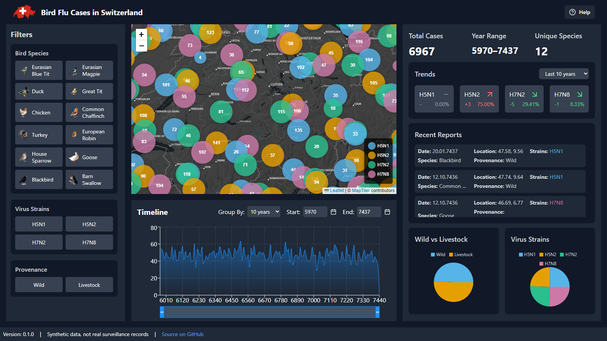
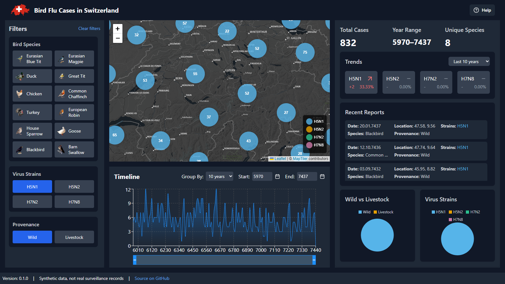

# Geodata Dashboard UI

[](https://github.com/raullopesalves/geodata-dashboard-ui/actions/workflows/ci.yml)

An interactive dashboard for exploring bird flu reports across Switzerland on a map, a timeline and summary charts.

**[Live demo](https://raullopesalves.github.io/geodata-dashboard-ui/)**

I built it in September 2024 as the technical assessment for a position at ETH Zurich. The brief was to turn a geotagged CSV of bird flu reports into a dashboard someone could filter and explore.



> **The data is synthetic.** All 10,000 reports in `public/fake_bird_data_switzerland_v2.csv` were generated for the assessment. Locations, species and strains are made up, and the years run from 5970 to 7437. Nothing here describes real outbreaks.

## What it does

- **Map**: shows every report as a point on a MapTiler base map, clustered by location and coloured by virus strain (H5N1, H5N2, H7N2, H7N8).
- **Filters**: narrow the data by 12 bird species, 4 strains and provenance (wild or livestock). The map, timeline and summary update together.
- **Timeline**: case counts over time, grouped into 10, 50, 100 or 500 year buckets. Drag the brush or pick start and end years to set the date range for the rest of the dashboard.
- **Summary**: total cases, year range, unique species, strain trends over a chosen window, the 10 most recent reports, and pie charts of provenance and strain.



## Stack

React 18 and TypeScript built with Vite (originally Create React App), Tailwind CSS, Leaflet with react-leaflet and marker clustering, Recharts for the timeline and pie charts, and PapaParse for reading the CSV. Tests run on Vitest.

## Running it locally

You need Node.js 22 or later and a free [MapTiler](https://www.maptiler.com/) API key for the base map.

```bash
git clone https://github.com/raullopesalves/geodata-dashboard-ui.git
cd geodata-dashboard-ui
npm install
```

Create a `.env` file in the project root:

```
VITE_MAPTILER_API_KEY=your_key_here
```

Then:

```bash
npm run dev      # dev server on http://localhost:3000
npm test         # run the tests
npm run lint     # check the code with ESLint
npm run build    # production build in build/
```

## Author

Raúl Alves · [LinkedIn](https://www.linkedin.com/in/ra%C3%BAl-alves-b870a8210/) · [GitHub](https://github.com/raullopesalves)
